# nanorock

A minimal Linux container runtime in C implemented directly from raw kernel primitives without daemons, databases, or external container libraries.

## Why nanorock?

Container runtimes like Docker, Podman, and `runc` are often perceived as monolithic virtualization systems. In reality, Linux has no native "container" primitive—a container is simply a standard Linux process isolated by kernel namespaces, restricted by cgroups, constrained by capability bounding sets, and filtered by seccomp.

`nanorock` was built to demonstrate this reality from first principles. By stripping away daemons, image layers, and third-party runtime wrappers, `nanorock` implements every phase of container isolation directly through raw Linux system calls (`clone`, `pivot_root`, `capset`, `prctl`, raw Netlink sockets, and Classic BPF bytecode). It serves as a clear, auditable reference for systems engineers, technical reviewers, and students studying operating systems internals.

## What it does

* **Namespaces (`CLONE_NEW*`)**: Spawns workloads into private PID, mount, network, UTS, and IPC namespaces. Workloads execute as PID 1 in their own process hierarchy.
* **Filesystem Pivot (`pivot_root`)**: Enforces a private mount tree (`MS_REC | MS_PRIVATE`), bind-mounts the rootfs, pivots the root, detaches and unmounts the host root, mounts a fresh `/proc`, and mounts an in-memory `tmpfs` on `/dev` with essential device nodes (`null`, `zero`, `full`, `random`, `urandom`, `tty`, `ptmx`).
* **Cgroup v2 Resource Enforcement**: Provisions dedicated cgroups under `/sys/fs/cgroup/nanorock/<name>-<pid>`, establishes memory quotas (`memory.max`), disables swap (`memory.swap.max = 0`), restricts CPU bandwidth (`cpu.max`), caps active processes (`pids.max`), and verifies all limits via readback.
* **Isolated Point-to-Point Networking**: Creates a virtual ethernet (`veth`) pair using raw Netlink (`rtnetlink`), moves the peer into the container netns as `eth0`, assigns static IPv4 addresses (`10.200.0.1/24` host, `10.200.0.2/24` container), configures the default gateway route, and brings up `lo`—all without invoking `/bin/ip` or shell utilities.
* **Capability Reduction**: Empties ambient capabilities (`PR_CAP_AMBIENT_CLEAR_ALL`), zeros inheritable capabilities via 64-bit `capset`, and strips 21 high-risk capabilities (`CAP_SYS_ADMIN`, `CAP_NET_ADMIN`, `CAP_SYS_MODULE`, etc.) from the bounding set.
* **Privilege Escalation Lockdown (`no_new_privs`)**: Sets `PR_SET_NO_NEW_PRIVS` and verifies it with `PR_GET_NO_NEW_PRIVS`, preventing setuid/setgid binaries and filesystem capabilities from escalating permissions.
* **Raw Classic BPF Seccomp Filter**: Loads an in-kernel BPF program verifying `AUDIT_ARCH_X86_64` and blocking 20+ dangerous syscalls (`reboot`, `kexec_load`, `mount`, `umount2`, `pivot_root`, `ptrace`, `bpf`, `userfaultfd`, `keyctl`) with `EPERM`.
* **Host Process Supervision**: Runs the host-side `nanorock` process as a supervisor that intercepts signals (`SIGINT`, `SIGTERM`, `SIGHUP`, `SIGQUIT`), forwards them to the container, monitors workload exit codes, terminates orphans on supervisor death (`PR_SET_PDEATHSIG`), and drains descendant processes via `cgroup.kill`.
* **Zero-Database Runtime Observability**: Implements `status` and `inspect` (`--json`) commands that query live state directly from `/sys/fs/cgroup` and `/proc` without maintaining state files or running background daemons.

## Architecture

```mermaid
flowchart TD
    A[CLI: nanorock run] --> B[Validate Configuration & Rootfs]
    B --> C[Create Cgroup v2 Hierarchy]
    C --> D[supervision_init: Install Signal Handlers]
    D --> E[clone into UTS, PID, Mount, Net, IPC Namespaces]

    subgraph Container Setup
        E --> F[Set Hostname]
        F --> G[pivot_root & Mount private /proc, /dev tmpfs]
        G --> H[Bring up lo interface]
        H --> I[Sync 'N': Netns Ready]
    end

    subgraph Host Network Setup
        I --> J[Parent creates veth pair via Netlink]
        J --> K[Inject peer into container netns as eth0]
        K --> L[Assign host IP 10.200.0.1 & bring UP]
        L --> M[Sync 'N': Network Injected]
    end

    M --> N[Child configures eth0 IP 10.200.0.2 & default route]
    N --> O[FD Hygiene: Close unneeded descriptors]
    O --> P[Child signals READY 'R' to Host]

    subgraph Cgroup Attachment
        P --> Q[Host moves child PID into cgroup.procs]
        Q --> R[Host verifies cgroup membership readback]
        R --> S[Host signals GO 'G' to Child]
    end

    subgraph Security Finalization & Exec
        S --> T[Drop Capabilities: ambient, inheritable, bounding]
        T --> U[prctl PR_SET_NO_NEW_PRIVS]
        U --> V[Install raw Classic BPF Seccomp Filter]
        V --> W[prctl PR_SET_PDEATHSIG]
        W --> X[execvp: Workload executes as PID 1]
    end

    subgraph Supervision & Teardown
        X --> Y[Host supervision_wait: EINTR & Signal Forwarding]
        Y --> Z[Workload Exits]
        Z --> AA[Drain & remove Cgroup: cgroup.kill]
        AA --> AB[Delete host veth interface via Netlink]
        AB --> AC[Exit with workload status]
    end
```



## Lifecycle

The container lifecycle proceeds through strict synchronization barriers:

1. **VALIDATE**: Command-line arguments, resource constraints, and the container rootfs directory are validated before any system mutation occurs.
2. **CREATE_CGROUP**: The host supervisor provisions a dedicated cgroup directory `/sys/fs/cgroup/nanorock/<name>-<pid>`, writes resource limits, and reads them back to ensure kernel controller support.
3. **CREATE_NAMESPACES**: The supervisor allocates a dynamic child stack with a `PROT_NONE` guard page and invokes `clone()` with five private namespaces.
4. **SETUP_ROOTFS**: Inside the new namespaces, the child makes the mount tree private, bind-mounts the rootfs, calls `pivot_root`, detaches the old root, mounts `/proc`, and mounts an in-memory `tmpfs` on `/dev`.
5. **SETUP_NETWORK**: The child signals the parent over pipe `c2p`. The parent creates a veth pair via Netlink, injects the peer into the child's netns, configures the host IP, and notifies the child. The child configures `eth0` and its default route.
6. **FD_HYGIENE**: The child closes all open file descriptors except standard I/O (0, 1, 2) and synchronization pipes.
7. **READY**: The child writes `'R'` to the synchronization pipe and blocks.
8. **ATTACH_CGROUP & VERIFY**: The host supervisor attaches the child PID to `cgroup.procs` and reads `cgroup.procs` back to verify membership before releasing the child.
9. **GO**: The host writes `'G'` to release the child.
10. **FINALIZE_SECURITY**: The child clears ambient and inheritable capabilities, drops 21 bounding capabilities, enables `no_new_privs`, installs the raw BPF seccomp filter, and sets `PR_SET_PDEATHSIG`.
11. **EXEC**: The child calls `execvp()`. The workload executes as PID 1 inside the container PID namespace.
12. **SUPERVISE**: The host supervisor forwards signals (`SIGINT`, `SIGTERM`, `SIGHUP`, `SIGQUIT`) to the container PID and waits for termination.
13. **CLEANUP**: On workload exit, the supervisor terminates lingering background processes via `cgroup.kill`, unlinks the cgroup directory, and deletes the host veth interface.

## Security model

`nanorock` implements defense-in-depth using multiple kernel isolation boundaries:

| Layer | Mechanism | Rationale & Protection |
|---|---|---|
| **Namespaces** | `CLONE_NEW*` | Isolates processes, filesystem mounts, network stack, hostname, and IPC. |
| **Filesystem Isolation** | `pivot_root` + `MNT_DETACH` | Swaps mount root. Old host rootfs is detached; failure to unmount is fatal (fail closed). `/dev` is mounted on private `tmpfs` to prevent host device node access. |
| **Cgroup Placement** | Synchronization Barrier | Workload execution is blocked until host confirms cgroup membership, preventing resource exhaustion races prior to limit application. |
| **Capabilities** | `prctl` + raw `capset` | Ambient cleared, inheritable zeroed, 21 bounding capabilities stripped (e.g. `CAP_SYS_ADMIN`, `CAP_NET_ADMIN`, `CAP_SYS_RAWIO`). Workload cannot perform privileged kernel administration. |
| **Privilege Escalation** | `PR_SET_NO_NEW_PRIVS` | Prevents setuid/setgid binaries or file capabilities from gaining privileges across `execve()`. |
| **Syscall Filtering** | Raw Classic BPF Seccomp | Validates architecture (`x86_64`) and denies dangerous syscalls (`reboot`, `mount`, `ptrace`, `bpf`, `keyctl`, etc.) with `EPERM`. |
| **Process Hygiene** | `PR_SET_PDEATHSIG` | Instructs kernel to send `SIGKILL` to container PID 1 if host supervisor dies, preventing orphaned containers. |
| **Descendant Cleanup** | `cgroup.kill` | Atomically terminates all lingering processes in the cgroup when the primary workload exits. |

## Networking

`nanorock` provides isolated point-to-point container networking using a virtual ethernet (`veth`) pair without external tooling:

```text
+-------------------------+                 +---------------------------+
|      Host Network       |                 |    Container Network      |
|        Namespace        |                 |        Namespace          |
|                         |                 |                           |
|   Interface: nrv-<pid>  |<=== veth pair ==|  Interface: eth0          |
|   IP: 10.200.0.1/24     |                 |  IP: 10.200.0.2/24        |
|                         |                 |  Default Gateway:         |
|                         |                 |    10.200.0.1             |
|                         |                 |  Interface: lo (127.0.0.1)|
+-------------------------+                 +---------------------------+
```

1. The host supervisor opens Netlink route socket (`AF_NETLINK`, `NETLINK_ROUTE`).
2. Creates veth pair with collision-resistant name `nrv-<child_pid>` and temporary peer name `nrp-<child_pid>`.
3. Moves the peer into `/proc/<child_pid>/ns/net` using Netlink `RTM_SETLINK` (`IFLA_NET_NS_FD`) and renames it directly to `eth0`.
4. Configures host IP (`10.200.0.1/24`) and brings `nrv-<pid>` UP via `SIOCSIFFLAGS` ioctl.
5. Inside the child netns, assigns container IP (`10.200.0.2/24`), adds default route to `10.200.0.1`, and verifies both `lo` and `eth0` are UP.
6. Upon container exit, the host supervisor issues Netlink `RTM_DELLINK` to delete `nrv-<pid>`, automatically destroying the peer interface.

## Build

### Prerequisites
* Linux kernel 5.14+ (cgroup v2 and `cgroup.kill` support)
* Architecture: x86_64
* GCC, GNU Make
* Root privileges (`CAP_SYS_ADMIN` required to configure namespaces and cgroups)

### Compilation
Build with strict systems hardening flags:
```bash
make clean
make
```

The Makefile enforces:
* `-Wall -Wextra -Werror -std=gnu11`
* `-fstack-protector-strong -D_FORTIFY_SOURCE=2`
* `-fPIE -pie -Wl,-z,relro,-z,now` (Full ASLR and RELRO)

To create a self-contained BusyBox test rootfs:
```bash
make rootfs
```

## Quick start

Launch an isolated container shell:
```bash
sudo bin/nanorock run --rootfs ./rootfs -- /bin/sh
```

Inside the container:
```text
/ # hostname
nanorock
/ # ps
PID   USER     COMMAND
    1 root     /bin/sh
    2 root     ps
/ # ip addr show eth0
2: eth0: <BROADCAST,MULTICAST,UP,LOWER_UP> mtu 1500 qdisc noqueue qlen 1000
    inet 10.200.0.2/24 scope global eth0
/ # ping -c 2 10.200.0.1
PING 10.200.0.1 (10.200.0.1): 56 data bytes
64 bytes from 10.200.0.1: seq=0 ttl=64 time=0.082 ms
64 bytes from 10.200.0.1: seq=1 ttl=64 time=0.076 ms
```

## Inspecting a container

`nanorock` inspects active containers without relying on a daemon or database.

### List Active Containers (`status`)
```bash
sudo bin/nanorock status
```
```text
CONTAINER          HOST_PID  CONT_PID  STATE    NET    MEM(CUR/MAX)     PIDS(CUR/MAX)  CPU_MAX
web-worker         4812      4813      running  veth   4.2MB / 64.0MB   3 / 25         50000 100000
```

Filter by container name:
```bash
sudo bin/nanorock status web-worker
```

### Detailed Inspection (`inspect`)
Human-readable inspection:
```bash
sudo bin/nanorock inspect web-worker
```
```text
Container: web-worker
  State:         running
  Host PID:      4812
  Container PID: 4813
  Cgroup Path:   /sys/fs/cgroup/nanorock/web-worker-4812
  Hostname:      worker-node-1
  Network:
    Mode:        veth
    IP:          10.200.0.2
  Resources:
    Memory:
      current:   4403200 bytes
      max:       67108864
      swap_max:  0
    CPU:
      max:       50000 100000
      usage:     12840 usec
    Processes:
      current:   3
      max:       25
```

### Machine-Readable JSON (`inspect --json`)
Pure dependency-free JSON serialization:
```bash
sudo bin/nanorock inspect web-worker --json
```
```json
{
  "name": "web-worker",
  "state": "running",
  "host_pid": 4812,
  "container_pid": 4813,
  "cgroup_path": "/sys/fs/cgroup/nanorock/web-worker-4812",
  "hostname": "worker-node-1",
  "network": {
    "mode": "veth",
    "ip": "10.200.0.2"
  },
  "resources": {
    "memory_current": 4403200,
    "memory_max": "67108864",
    "memory_swap_max": "0",
    "cpu_max": "50000 100000",
    "cpu_usage_usec": 12840,
    "pids_current": 3,
    "pids_max": "25"
  }
}
```

## Resource limits

Enforce memory limits, CPU bandwidth ceilings, and process quotas:

```bash
sudo bin/nanorock run \
  --rootfs ./rootfs \
  --name app-box \
  --hostname app-1 \
  --mem 64 \
  --cpu 50 \
  --pids-max 30 \
  -- /bin/sh
```

* `--mem 64`: Enforces 64 MB maximum memory (`memory.max = 67108864`) and disables swap (`memory.swap.max = 0`). Exceeding memory triggers the cgroup out-of-memory killer.
* `--cpu 50`: Restricts CPU bandwidth to 50% of a single core (`cpu.max = 50000 100000` microseconds).
* `--pids-max 30`: Restricts total processes inside the container to 30 (`pids.max = 30`), mitigating fork-bombs.

## Testing

Run the complete 9-suite behavioral verification test suite:

```bash
sudo make test
```

All 206 assertions must pass:
1. `tests/test_isolation.sh`: UTS, PID, Mount, and Network namespace isolation (12 assertions).
2. `tests/test_milestone2.sh`: Native loopback ioctl, FD sanitation, `/dev` tmpfs, pivot_root detachment (10 assertions).
3. `tests/test_cgroups.sh`: Cgroup v2 naming, controller checks, readback verification, OOM killer, `cgroup.kill` (14 assertions).
4. `tests/test_security.sh`: Capability sets (`CapAmb`, `CapInh`, `CapBnd`, `CapPrm`, `CapEff`), `no_new_privs`, and raw Classic BPF seccomp denials (20 assertions).
5. `tests/test_milestone5.sh`: Host supervisor, signal forwarding (`SIGINT`, `SIGTERM`, `SIGHUP`, `SIGQUIT`), exit codes, and `PR_SET_PDEATHSIG` (11 assertions).
6. `tests/test_milestone6.sh`: CLI validation, RFC 1123 hostname rules, exit code policy, verbose logging, and `--no-seccomp` bypass (29 assertions).
7. `tests/test_milestone7.sh`: Netlink veth configuration, container `eth0` routing, bidirectional ping, and cleanup on exit/signals (24 assertions).
8. `tests/test_milestone8.sh`: Runtime lifecycle hardening, zero FD leaks (`fd_probe`), idempotent cleanup, and stress testing (36 assertions).
9. `tests/test_milestone9_10.sh`: Status table, inspect formatting, dependency-free JSON validation, and live cgroup observability (50 assertions).

## Project structure

```text
nanorock/
├── include/
│   ├── capabilities.h     # Capability reduction and ambient/inheritable clearing
│   ├── cgroups.h          # Cgroup v2 setup, limit verification, and process draining
│   ├── config.h           # Runtime configuration structures and exit code policies
│   ├── error.h            # Structured error definitions across initialization phases
│   ├── fd.h               # File descriptor sanitation and FD leak prevention
│   ├── log.h              # Diagnostic, informational, and error logging utilities
│   ├── mount_setup.h      # pivot_root, mount namespace isolation, and /dev tmpfs
│   ├── namespaces.h       # clone() dispatch, sync pipes, and child startup
│   ├── network.h          # Raw Netlink veth creation, peer injection, and routing
│   ├── seccomp_filter.h   # Raw Classic BPF seccomp filter definition
│   ├── status.h           # Container discovery, status reporting, and JSON inspection
│   └── supervision.h      # Process supervision, signal forwarding, and waitpid handling
│
├── src/
│   ├── capabilities.c     # PR_CAPBSET_DROP, PR_CAP_AMBIENT_CLEAR_ALL, capset
│   ├── cgroups.c          # /sys/fs/cgroup controller configuration and cgroup.kill
│   ├── fd.c               # /proc/self/fd inspection and descriptor hygiene
│   ├── log.c              # Colored console logging and verbose diagnostics
│   ├── main.c             # CLI parsing, lifecycle orchestration, and main entrypoint
│   ├── mount_setup.c      # pivot_root, MS_REC|MS_PRIVATE, and tmpfs /dev nodes
│   ├── namespaces.c       # Child process initialization and synchronization handshakes
│   ├── network.c          # Netlink RTM_NEWLINK, RTM_NEWADDR, RTM_NEWROUTE, ioctl
│   ├── seccomp_filter.c   # Raw sock_filter bytecode for syscall denylist
│   ├── status.c           # Status table and dependency-free JSON generation
│   └── supervision.c      # sigaction without SA_RESTART and waitpid supervision loop
│
├── tests/
│   ├── test_isolation.sh      # Milestone 1: namespace isolation
│   ├── test_milestone2.sh     # Milestone 2: mount and loopback
│   ├── test_cgroups.sh        # Milestone 3: cgroup v2 limits
│   ├── test_security.sh       # Milestone 4: capabilities and seccomp
│   ├── test_milestone5.sh     # Milestone 5: supervision and signals
│   ├── test_milestone6.sh     # Milestone 6: CLI validation
│   ├── test_milestone7.sh     # Milestone 7: veth networking
│   ├── test_milestone8.sh     # Milestone 8: lifecycle hardening and FD hygiene
│   ├── test_milestone9_10.sh  # Milestones 9 & 10: status, inspect, and observability
│   ├── fd_probe.c             # Test binary: verifies zero file descriptor leaks
│   └── security_probe.c       # Test binary: asserts capability and seccomp boundaries
│
├── scripts/
│   └── setup-rootfs.sh    # Script to create a minimal BusyBox rootfs
│
├── docs/
│   └── ARCHITECTURE.md    # Detailed top-to-bottom systems engineering guide
│
├── Makefile               # Strict compilation and test runner targets
├── README.md              # Project overview and technical documentation
├── CONTRIBUTING.md        # Contribution and code quality guidelines
└── LICENSE                # MIT License
```

## Design decisions

* **Why host-side supervision?** Running the supervisor on the host avoids placing runtime binaries or daemons inside the container rootfs, preserving workload isolation and keeping the container rootfs unmodified.
* **Why workload as PID 1?** Linux PID namespaces require an init process to adopt orphaned child processes. Placing the workload directly as PID 1 mirrors standard systems runtime behavior without artificial wrapper layers.
* **Why cgroup placement before GO?** If the workload were allowed to execute before cgroup placement, a fast or adversarial process could consume unbounded memory or fork-bomb the host before limits took effect.
* **Why verify cgroup membership?** Writing a PID to `cgroup.procs` can fail silently or race with process exit; reading back `cgroup.procs` guarantees the kernel has committed the process to the control group.
* **Why no background daemon?** A daemon introduces IPC overhead, failure state synchronization, and crash recovery complexity. The kernel already tracks process and control group state; a daemon is redundant for a minimal runtime.
* **Why no database?** Storing state on disk creates cache-invalidation bugs when processes are killed externally. Inspecting `/proc` and `/sys/fs/cgroup` provides an authoritative, self-healing source of truth.
* **Why raw Netlink instead of `iproute2`?** Executing shell commands (`/bin/ip`) inside a runtime introduces external binary dependencies, PATH hijacking risks, and slow process spawning overhead. Raw Netlink talks directly to the kernel network subsystem.
* **Why raw Classic BPF instead of `libseccomp`?** Generating BPF bytecode directly using standard kernel headers (`linux/filter.h`, `linux/seccomp.h`) eliminates third-party shared library dependencies and demonstrates the exact instruction-level execution of the BPF virtual machine.
* **Why veth-only point-to-point networking?** A virtual ethernet pair is the minimal primitive required to connect two network namespaces. Complex bridge networks or IP masquerading obscure the core mechanics of network namespaces.
* **Why root-based operation?** Setting up mount namespaces, device nodes, veth interfaces, and cgroup v2 controllers requires `CAP_SYS_ADMIN` and `CAP_NET_ADMIN` on the host. Running as root allows direct access to kernel primitives without the complexity of user namespace UID mapping.

## Limitations

`nanorock` is an educational, minimalist systems project. It intentionally does not attempt to provide:

* **User Namespaces / Rootless Containers**: Container UID 0 maps directly to host UID 0. While capabilities and seccomp severely constrain operations, `nanorock` is not a secure multi-tenant sandbox against malicious root workloads.
* **Outbound Internet / NAT**: The network subsystem provides a private host-to-container point-to-point link (`10.200.0.1` <-> `10.200.0.2`). NAT iptables/nftables masquerading is not implemented.
* **DNS Resolution / DHCP**: No `/etc/resolv.conf` injection or DHCP client configuration is performed.
* **IPv6 Support**: Networking is strictly IPv4.
* **Container-to-Container Bridging**: Each container connects solely to the host via its dedicated veth pair.
* **Architecture Portability**: The Classic BPF seccomp filter enforces `AUDIT_ARCH_X86_64` syscall numbering and will fail closed on other CPU architectures.
* **Persistent Historical State**: When a container terminates, its cgroup and veth pair are deleted. `nanorock` does not maintain logs of stopped containers.
* **Docker / OCI Image Compatibility**: `nanorock` operates on extracted rootfs directories; it does not pull, unpack, or manage OCI/Docker container images.

## Project status

Milestones 1 through 10 are complete. The repository represents a finalized, fully verified systems engineering implementation ready for academic evaluation, code walkthroughs, and portfolio review.
