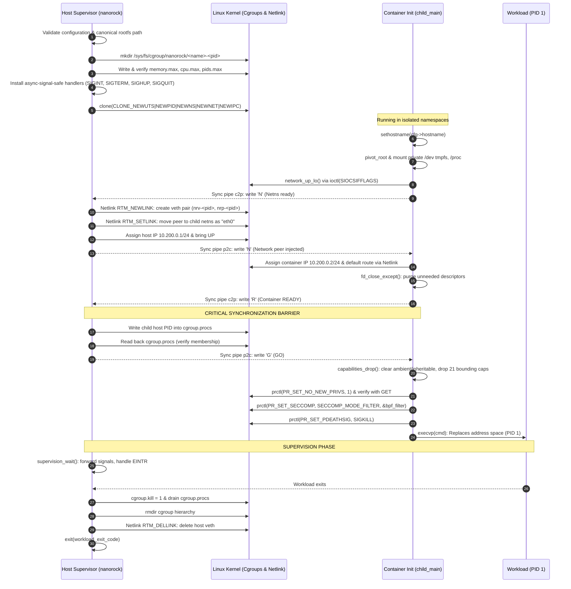

# nanorock Architecture & System Internals

`nanorock` is a minimal, dependency-free Linux container runtime written in C. It implements containerization directly using Linux kernel primitives: namespaces, mount trees, cgroup v2 controllers, capabilities, `prctl`, raw Netlink sockets, and Classic BPF seccomp filters.

This document provides a comprehensive technical breakdown of nanorock's architecture, process model, lifecycle synchronization, security boundaries, and operational characteristics.

---

## 1. Architectural Philosophy

Traditional container engines (such as Docker or Podman) operate via background daemon processes, persistent state stores (e.g. SQLite or BoltDB), complex networking daemon plugins, and layered OCI runtime wrappers (`containerd` $\to$ `runc`).

`nanorock` is built on three core design principles:

1. **Direct Kernel Primitives**: No intermediate container abstractions or third-party libraries (`libcap`, `libseccomp`, `libnetlink`). Every operation interacts directly with kernel system calls, Netlink sockets, or pseudo-filesystems (`/proc`, `/sys/fs/cgroup`).
2. **Host-Side Supervision**: The host-side `nanorock` process acts directly as the supervisor. The container workload runs as PID 1 in its own PID namespace. There is no in-container init wrapper, daemon, or embedded agent.
3. **The Kernel is the Database**: There is no runtime state database, cache, or daemon. Container existence, process mapping, networking state, and resource utilization are derived on demand from `/sys/fs/cgroup` and `/proc`.

---

## 2. System Components

| Component | Source Files | Primary Responsibilities |
|---|---|---|
| **CLI & Orchestration** | [`src/main.c`](../src/main.c), [`include/config.h`](../include/config.h) | Parses flags, validates input grammar, executes rootfs validation, and drives the 13-stage lifecycle state machine. |
| **Namespaces & Process Init** | [`src/namespaces.c`](../src/namespaces.c), [`include/namespaces.h`](../include/namespaces.h) | Spawns child into private UTS, PID, NS, NET, and IPC namespaces via `clone()`; executes child setup and bidirectional handshake protocol. |
| **Filesystem & Mounts** | [`src/mount_setup.c`](../src/mount_setup.c), [`include/mount_setup.h`](../include/mount_setup.h) | Makes mount tree private (`MS_REC \| MS_PRIVATE`), bind-mounts rootfs, executes `pivot_root`, detaches old root, mounts `/proc` and private `/dev` `tmpfs`. |
| **Cgroup v2 Resource Control** | [`src/cgroups.c`](../src/cgroups.c), [`include/cgroups.h`](../include/cgroups.h) | Provisions dedicated cgroups under `/sys/fs/cgroup/nanorock/`, sets memory/CPU/PIDs limits, verifies via readback, attaches child PID, and drains descendants via `cgroup.kill`. |
| **Network Subsystem** | [`src/network.c`](../src/network.c), [`include/network.h`](../include/network.h) | Configures loopback interface (`lo`), creates host/container `veth` pair over raw Netlink, moves peer to child netns as `eth0`, assigns static IPs, and sets default route. |
| **Capability Management** | [`src/capabilities.c`](../src/capabilities.c), [`include/capabilities.h`](../include/capabilities.h) | Empties ambient capability set, zeros inheritable set via 64-bit `capset`, and strips 21 high-risk capabilities from the bounding set. |
| **Syscall Filtering (Seccomp)** | [`src/seccomp_filter.c`](../src/seccomp_filter.c), [`include/seccomp_filter.h`](../include/seccomp_filter.h) | Generates and installs raw Classic BPF instruction bytecode verifying architecture (`AUDIT_ARCH_X86_64`) and blocking dangerous syscalls with `EPERM`. |
| **Process Supervision** | [`src/supervision.c`](../src/supervision.c), [`include/supervision.h`](../include/supervision.h) | Installs async-signal-safe signal handlers (`sa_flags = 0`), loops `waitpid()` handling `EINTR`, forwards signals to container PID, and maps exit statuses. |
| **FD Hygiene & Stack** | [`src/fd.c`](../src/fd.c), [`include/fd.h`](../include/fd.h) | Closes all open file descriptors above `STDERR_FILENO` except synchronization pipes; allocates dynamic child stack with a `PROT_NONE` guard page. |
| **Status & Inspection** | [`src/status.c`](../src/status.c), [`include/status.h`](../include/status.h) | Discovers running containers via `/sys/fs/cgroup/nanorock/`, queries `/proc` and UTS namespaces, and formats output as tables or pure JSON. |
| **Logging & Diagnostics** | [`src/log.c`](../src/log.c), [`include/log.h`](../include/log.h) | Formatted, colored stderr logging with verbose multi-stage lifecycle diagnostics. |

---

## 3. Architecture & Synchronization Diagram



---

## 4. Startup Sequence & Synchronization Invariants

The sequence of operations during startup is intentionally structured to ensure **fail-closed security** and eliminate race conditions:

### Why Cgroup Placement Occurs Before the GO Signal
A critical vulnerability in naive container runtimes is the "early escape" race: if a container process executes before resource limits are enforced, a malicious workload could spawn thousands of threads or consume all physical memory before the supervisor attaches it to a cgroup.
In `nanorock`:
1. The container child pauses execution at step 7 and blocks on `read(p2c_fd, &go, 1)`.
2. The host supervisor writes the child's host PID to `/sys/fs/cgroup/nanorock/<name>-<pid>/cgroup.procs`.
3. The host reads `cgroup.procs` back to verify that the PID is present and accounted for by the kernel.
4. Only after readback verification succeeds does the host send the `'G'` (GO) byte over the synchronization pipe.

### Why Capabilities & Seccomp are Applied Immediately Before Exec
Privileged setup (such as bind-mounting the rootfs, issuing `pivot_root`, mounting `/proc`, creating character device nodes in `/dev`, and configuring network interfaces via Netlink) requires `CAP_SYS_ADMIN` and `CAP_NET_ADMIN`.
Consequently:
1. All trusted namespace and mount setup runs first.
2. Capability drops (`PR_CAPBSET_DROP`, ambient clearing, inheritable zeroing), `PR_SET_NO_NEW_PRIVS`, and raw BPF seccomp filtering are executed as the **final actions before `execvp()`**.
3. Once dropped, `PR_SET_NO_NEW_PRIVS` ensures that the workload can never regain those privileges.

---

## 5. Process Model

```text
[ Host PID Namespace ]
nanorock (supervisor) [Host PID: 1042]
  │
  │  (manages: cgroups, signal forwarding, veth interface, waitpid)
  │
  ▼
[ Container PID Namespace ]
workload (command)    [Host PID: 1043, Container PID: 1]
  │
  ├─ child worker     [Host PID: 1050, Container PID: 2]
  └─ child worker     [Host PID: 1051, Container PID: 3]
```

### Why Workload as PID 1?
In Linux, the process with PID 1 inside a PID namespace has special responsibilities:
- It adopts orphaned descendant processes.
- If PID 1 terminates, the kernel delivers `SIGKILL` to all other processes inside that PID namespace.

By making the user's workload PID 1 directly, `nanorock` avoids running an unnecessary intermediate shell or wrapper script inside the container rootfs.

### Why No In-Container Daemon or Supervisor?
Embedding an agent inside the container rootfs requires polluting the container filesystem with host binaries, managing shared IPC channels, and handling complex synchronization. Operating strictly from the host side keeps the container rootfs 100% pristine and unaltered.

---

## 6. Cleanup & Teardown Model

`nanorock` guarantees idempotent, leak-free resource cleanup across all termination paths:

### 1. Normal Workload Exit
When container PID 1 calls `exit(code)`:
- The host supervisor's `waitpid()` returns.
- The supervisor writes `1` to `/sys/fs/cgroup/nanorock/<name>-<pid>/cgroup.kill` to terminate any orphaned background descendants.
- The supervisor polls `cgroup.procs` until it is empty, then calls `rmdir()` on the cgroup path.
- The supervisor sends Netlink `RTM_DELLINK` to delete `nrv-<child_pid>`, which automatically cleans up the paired container interface.
- The supervisor exits with the workload's exact exit code.

### 2. Forwarded Signal Termination
- When the host supervisor receives `SIGINT`, `SIGTERM`, `SIGHUP`, or `SIGQUIT`, the async-signal-safe handler flags the pending signal.
- The supervisor's `waitpid()` loop is interrupted with `errno == EINTR`.
- The supervisor forwards the signal to the container child PID via `kill(child_pid, signo)`.
- If the workload terminates due to a signal, `supervision_translate_status()` translates the status to `128 + signo` (e.g. 130 for `SIGINT`, 143 for `SIGTERM`).

### 3. Abrupt Parent Death (`PR_SET_PDEATHSIG`)
If the host supervisor process is forcefully killed (`kill -9`):
- The supervisor cannot run its cleanup handlers.
- The Linux kernel detects parent death and immediately delivers `SIGKILL` to the child process because the child configured `prctl(PR_SET_PDEATHSIG, SIGKILL)` before `execvp()`.
- The death of container PID 1 causes the kernel to terminate the entire PID namespace, preventing orphaned container processes on the host.

### 4. Initialization Failure (Fail-Closed)
If an error occurs during child or host setup:
- The error is captured into a structured `nanorock_error_t` payload and reported over the `c2p` pipe.
- The supervisor logs the exact failure phase and `errno`.
- The supervisor immediately invokes `cgroup_cleanup()` and `network_host_cleanup()` before terminating with runtime error code `1`.

---

## 7. Security Model & Boundaries

### Linux Capabilities
Linux divides root privileges into distinct capabilities. `nanorock` enforces a strict three-part capability reduction:
1. **Ambient Capabilities**: Cleared via `prctl(PR_CAP_AMBIENT, PR_CAP_AMBIENT_CLEAR_ALL, 0, 0, 0)`.
2. **Inheritable Capabilities**: Zeroed using raw 64-bit `capset` (`_LINUX_CAPABILITY_VERSION_3`).
3. **Bounding Set (`CapBnd`)**: 21 dangerous capabilities dropped via `prctl(PR_CAPBSET_DROP)`:
   - Administration: `CAP_SYS_ADMIN`, `CAP_SYS_MODULE`, `CAP_SYS_RAWIO`, `CAP_SYS_BOOT`, `CAP_SYS_PACCT`, `CAP_SYS_TTY_CONFIG`
   - Networking & Tracing: `CAP_NET_ADMIN`, `CAP_SYS_PTRACE`
   - Clocks & Hardware: `CAP_SYS_TIME`, `CAP_WAKE_ALARM`, `CAP_BLOCK_SUSPEND`
   - Mandatory Access Control: `CAP_MAC_ADMIN`, `CAP_MAC_OVERRIDE`
   - Security & Audit: `CAP_AUDIT_CONTROL`, `CAP_AUDIT_READ`, `CAP_SYSLOG`, `CAP_DAC_READ_SEARCH`
   - Kernel Extensions: `CAP_BPF`, `CAP_PERFMON`, `CAP_CHECKPOINT_RESTORE`, `CAP_SYS_RESOURCE`

Under Linux capability transformation rules, when UID 0 executes a non-setuid binary:
$$P'(\text{permitted}) = \text{cap\_bset}$$
$$P'(\text{effective}) = P'(\text{permitted})$$
Therefore, stripping these 21 capabilities from the bounding set permanently prevents the workload from exercising them.

### Privilege Escalation Lockdown (`no_new_privs`)
`prctl(PR_SET_NO_NEW_PRIVS, 1, 0, 0, 0)` is asserted and verified via `PR_GET_NO_NEW_PRIVS`. This guarantees:
- Setuid/setgid binaries inside the rootfs cannot elevate privileges.
- Filesystem capability attributes (`security.capability`) are ignored.
- Seccomp filters cannot be disabled or relaxed by descendant processes.

### Raw Classic BPF Seccomp Filter
`nanorock` constructs raw Berkeley Packet Filter bytecode (`struct sock_filter`) without `libseccomp`:

```text
[Instruction 0] Load seccomp_data.arch (offset 4)
[Instruction 1] Jump if arch == AUDIT_ARCH_X86_64 else jump to Kill
[Instruction 2] SECCOMP_RET_KILL_PROCESS (Architecture mismatch)
[Instruction 3] Load seccomp_data.nr (offset 0, syscall number)
[Instructions 4..63] JEQ on denied syscalls -> SECCOMP_RET_ERRNO(EPERM)
[Instruction 64] SECCOMP_RET_ALLOW (Permit normal syscalls)
```

Blocked syscall categories include:
- Kernel replacement: `reboot`, `kexec_load`, `kexec_file_load`
- Module loading: `init_module`, `finit_module`, `delete_module`
- Mount manipulation: `mount`, `umount2`, `pivot_root`
- Namespace mutations: `unshare`, `setns`
- Process tracing: `ptrace`, `process_vm_readv`, `process_vm_writev`
- Kernel attack surface: `bpf`, `perf_event_open`, `userfaultfd`, `keyctl`, `open_by_handle_at`, `io_uring_setup`, `swapon`, `swapoff`

---

## 8. Operational Model: Kernel as Database

`nanorock status` and `nanorock inspect <name> [--json]` demonstrate that a container runtime does not require a local SQLite database or daemon to maintain accurate runtime state.

```text
Host File System Path                   Runtime Information Extracted
-----------------------------------     -----------------------------------------
/sys/fs/cgroup/nanorock/<name>-<pid>/   Container identity & supervisor host PID
.../cgroup.procs                        Active workload PID (first line)
.../memory.current                      Real-time resident memory in bytes
.../memory.max                          Configured memory ceiling
.../memory.swap.max                     Configured swap limit (0)
.../cpu.max                             CPU quota and period window
.../cpu.stat (usage_usec)               Cumulative CPU time consumed
.../pids.current                        Active process count inside container
.../pids.max                            Configured process limit

/proc/<container_pid>/ns/uts            Transient setns query for hostname
/proc/<container_pid>/net/dev           Network mode ('veth' if eth0 exists)
/proc/<container_pid>/net/fib_trie      Assigned container IPv4 address (/32 LOCAL)
```

### UTS Hostname Extraction Without Interference
To inspect the true container hostname without running code inside the container or reading arbitrary filesystem files:
1. `nanorock` opens `/proc/<container_pid>/ns/uts` and `/proc/self/ns/uts`.
2. Calls `setns(target_uts, CLONE_NEWUTS)` to temporarily join the container's UTS namespace.
3. Invokes `uname()` to read the true nodename.
4. Immediately calls `setns(cur_uts, CLONE_NEWUTS)` to restore the host UTS namespace.

### Dependency-Free JSON Serialization
`nanorock inspect <name> --json` implements an in-tree JSON serializer with full character escaping (`\"`, `\\`, `\n`, `\t`, control characters) directly in C, eliminating dependencies on external JSON libraries.

---

## 9. Error Handling Strategy

Every critical operation in `nanorock` enforces strict error handling:
- All system calls that return negative values are checked.
- On fatal setup errors, `nanorock` records the exact phase (`nanorock_error_phase_t`), system error code (`errno`), and contextual message.
- The supervisor guarantees resource teardown (cgroup deletion and veth deletion) even on abnormal termination paths.
- The CLI enforces deterministic exit codes:
  - `0..255`: Workload exit status
  - `128 + N`: Workload killed by signal `N`
  - `1`: Runtime or setup failure
  - `2`: CLI argument or usage validation error

---

## 10. Technical Boundaries & Intentional Limitations

* **Root Privileges Required**: `nanorock` does not implement rootless user namespaces (`CLONE_NEWUSER`). Root privileges (`sudo`) are required to manage mount namespaces, cgroup controllers, and network devices.
* **Point-to-Point Networking Only**: No NAT masquerading, bridge sharing, DNS forwarding, DHCP, or IPv6 is implemented. Containers communicate exclusively with the host over their private veth link (`10.200.0.1` <-> `10.200.0.2`).
* **Architecture**: The raw Classic BPF filter explicitly requires x86_64 architecture (`AUDIT_ARCH_X86_64`).
* **Non-Persistent State**: Stopped containers leave no artifacts or metadata on disk.
